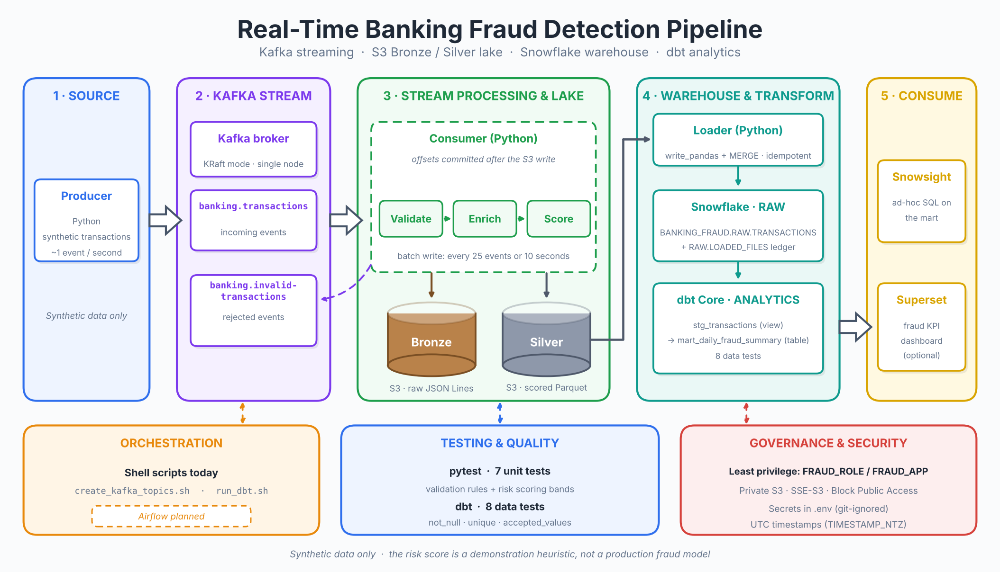
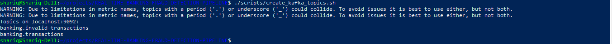
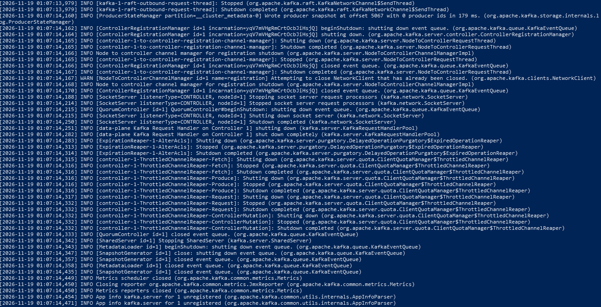
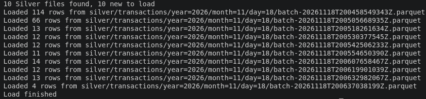
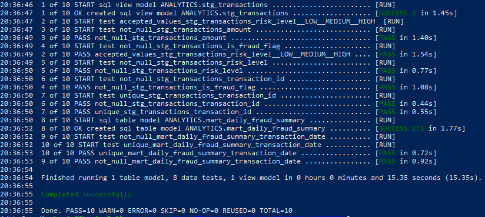
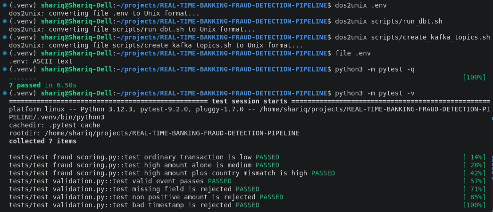
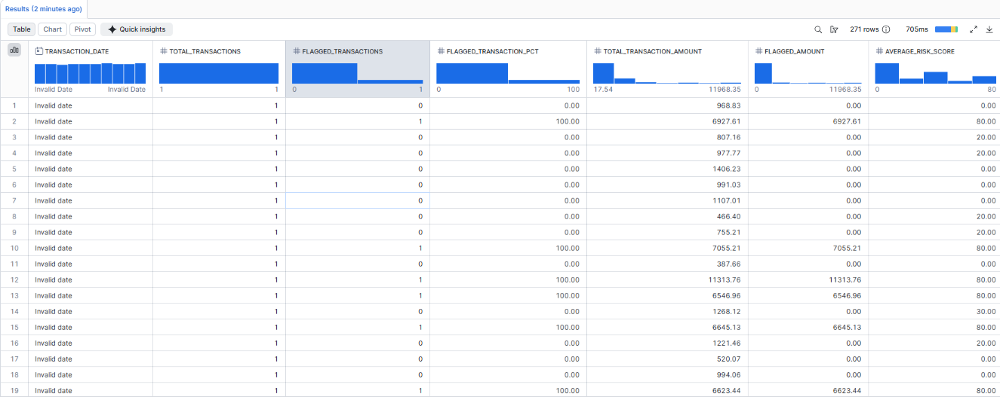

<h1 align="center">Real-Time Banking Fraud Detection Pipeline</h1>

<p align="center">
  <b>Kafka</b> &rarr; <b>S3 Bronze / Silver</b> &rarr; <b>Snowflake</b> &rarr; <b>dbt</b><br>
  An end-to-end streaming data engineering project: synthetic bank transactions are validated,
  enriched and risk-scored in flight, stored in a lakehouse-style S3 layout, loaded idempotently
  into Snowflake, and modeled with tested dbt analytics.
</p>

<p align="center">
  
  
  
  
  
  
  
</p>

<p align="center">
  
  
  
  
</p>

<p align="center">
  <a href="#-highlights">Highlights</a> &middot;
  <a href="#-architecture">Architecture</a> &middot;
  <a href="#-skills-demonstrated">Skills</a> &middot;
  <a href="#-quick-start">Quick start</a> &middot;
  <a href="#-running-the-pipeline">Run it</a> &middot;
  <a href="#-testing">Testing</a> &middot;
  <a href="#-risk-scoring-rules">Risk rules</a> &middot;
  <a href="#-author">Author</a>
</p>

> **Disclaimer:** This project uses synthetic data only. The risk score is a demonstration heuristic, not a production fraud model.

---

## Table of contents

1. [Highlights](#-highlights)
2. [Architecture](#-architecture)
3. [Skills demonstrated](#-skills-demonstrated)
4. [Tech stack](#-tech-stack)
5. [Project structure](#-project-structure)
6. [Quick start](#-quick-start)
7. [Detailed setup](#-detailed-setup)
8. [Running the pipeline](#-running-the-pipeline)
9. [Testing](#-testing)
10. [Risk scoring rules](#-risk-scoring-rules)
11. [Design decisions](#-design-decisions)
12. [Troubleshooting](#-troubleshooting)
13. [Known limitations](#-known-limitations)
14. [Future improvements](#-future-improvements)
15. [Security](#-security)
16. [Author](#-author)

---

## ✨ Highlights

- **Streaming ingestion with Kafka.** A producer publishes synthetic transactions to `banking.transactions`; events that fail validation are routed to a separate `banking.invalid-transactions` topic instead of being dropped.
- **Explainable scoring in flight.** Each event is validated, enriched and scored with a transparent rule set. Every point added to the score carries a reason code.
- **Lakehouse-style storage.** The consumer writes a raw **Bronze** layer (JSON Lines) and a curated **Silver** layer (Parquet) to S3, partitioned by `year / month / day`.
- **Safe, repeatable loading.** The loader merges Silver files into Snowflake with `MERGE` and records every file in a ledger table, so reruns never duplicate data.
- **Tested analytics layer.** dbt builds a staging view and a mart table with data tests, and `pytest` covers validation and scoring logic.
- **Security-minded setup.** Least-privilege Snowflake role, private encrypted S3 bucket, secrets kept out of Git.

### Results from the captured run

| Metric | Result |
|---|---|
| Transactions loaded into Snowflake | **271** rows from **10** Silver Parquet files |
| dbt build | **PASS=10** (1 view, 1 table, 8 data tests), 0 warnings, 0 errors, 15.35 s |
| Unit tests | **7 / 7** passed with `pytest` |
| Risk scores observed in the mart | 0, 20, 30 and 80; events at HIGH are flagged |

---

## 🧱 Architecture

<p align="center">
  
  <br>
  <sub><i>End-to-end architecture. Solid arrows show data flow; dashed arrows show rejected events and cross-cutting concerns.</i></sub>
</p>

```text
producer            generate_transactions.py
   |
   v
Kafka topic         banking.transactions
   |
   v
consumer            validate -> enrich -> score -> write batches
   |   \
   |    +--> Kafka topic  banking.invalid-transactions   (rejected events)
   v
S3 Bronze (raw JSONL)   and   S3 Silver (scored Parquet)
   |
   v
loader              load_s3_to_snowflake.py   (MERGE, idempotent)
   |
   v
Snowflake           BANKING_FRAUD.RAW.TRANSACTIONS
   |
   v
dbt                 stg_transactions (view) -> mart_daily_fraud_summary (table)
   |
   v
Superset dashboard  (optional)
```

| Component | Responsibility |
|---|---|
| **Producer** | Generates synthetic transactions and publishes them to Kafka |
| **Kafka** | Buffers and delivers events; holds invalid events in their own topic |
| **Consumer** | Validates, enriches and scores each event; writes batches to S3 |
| **S3** | Stores Bronze (raw) and Silver (curated) files |
| **Loader** | Reads Silver files and merges them into Snowflake |
| **Snowflake** | Stores the queryable warehouse tables |
| **dbt** | Builds staging and mart models and runs data tests |
| **Superset** | Displays fraud KPIs (optional) |

---

## 🎯 Skills demonstrated

| Area | What this project shows |
|---|---|
| **Streaming** | Kafka in KRaft mode, producer/consumer design, dead-letter style routing of invalid events, offsets committed after durable writes |
| **Data lake design** | Bronze (JSONL) and Silver (Parquet) layers with date-partitioned S3 keys and batched writes |
| **Warehouse engineering** | Idempotent loads with `MERGE`, a loaded-files ledger, Snowflake roles, warehouses and auto-suspend |
| **Analytics engineering** | dbt staging and mart models, schema tests (`not_null`, `unique`, `accepted_values`) |
| **Software quality** | Modular Python packages, `pytest` unit tests, configuration through environment variables |
| **Security and cost** | Least privilege, private S3 with SSE-S3, no secrets in Git, small synthetic workloads |

## 🧰 Tech stack

| Layer | Technology |
|---|---|
| Language | Python 3.10+ |
| Streaming | Apache Kafka (KRaft mode, single broker) |
| Data lake | AWS S3 (Bronze: JSON Lines, Silver: Parquet) |
| Warehouse | Snowflake |
| Transformation and testing | dbt Core with `dbt-snowflake` |
| Dashboard (optional) | Apache Superset |
| Unit testing | pytest |

---

## 📁 Project structure

```text
realtime-banking-fraud-detection/
├── config/                       Shared settings loaded from .env
│   ├── __init__.py
│   └── settings.py
├── producer/                     Kafka producer (synthetic data)
│   ├── generate_transactions.py
│   └── requirements.txt
├── consumer/                     Kafka consumer (validate, enrich, score)
│   ├── fraud_consumer.py
│   ├── requirements.txt
│   ├── processing/
│   │   ├── validation.py
│   │   ├── enrichment.py
│   │   └── fraud_scoring.py
│   └── storage/
│       └── s3_writer.py
├── loader/                       S3 Silver to Snowflake loader
│   ├── load_s3_to_snowflake.py
│   └── requirements.txt
├── snowflake/                    Snowflake setup SQL
│   ├── 01_create_objects.sql
│   └── 02_security_roles.sql
├── dbt_fraud/                    dbt project (Snowflake adapter)
│   ├── dbt_project.yml
│   ├── profiles.yml
│   ├── requirements.txt
│   └── models/
│       ├── staging/
│       │   ├── sources.yml
│       │   ├── stg_transactions.sql
│       │   └── stg_transactions.yml
│       └── marts/
│           ├── mart_daily_fraud_summary.sql
│           └── mart_daily_fraud_summary.yml
├── scripts/                      Helper scripts and checks
│   ├── check_snowflake.py
│   ├── create_kafka_topics.sh
│   └── run_dbt.sh
├── tests/                        pytest unit tests
│   ├── requirements.txt
│   ├── test_validation.py
│   └── test_fraud_scoring.py
├── docs/
│   ├── architecture.png
│   └── screenshots/              Evidence from a real run
├── .env.example
├── .gitignore
├── requirements.txt              Root Python dependencies
├── README.md
└── SETUP_GUIDE.md
```

---

## ⚡ Quick start

Run these once the prerequisites are installed. The [detailed setup](#-detailed-setup) below explains each step.

| Step | Action |
|---|---|
| 1 | Clone the repo and create the virtual environment, then `pip install -r requirements.txt` |
| 2 | Copy `.env.example` to `.env` and fill in AWS, Kafka and Snowflake values |
| 3 | Run `snowflake/01_create_objects.sql` (SYSADMIN) and `02_security_roles.sql` (ACCOUNTADMIN) |
| 4 | Create a private S3 bucket and run `aws sts get-caller-identity` to confirm access |
| 5 | Start the Kafka broker and run `./scripts/create_kafka_topics.sh` |
| 6 | Start the consumer, then the producer |
| 7 | Load Silver data with `python -m loader.load_s3_to_snowflake` |
| 8 | Build models with `./scripts/run_dbt.sh build` and run `python -m pytest -q` |

```bash
git clone <your-repo-url>
cd realtime-banking-fraud-detection

python -m venv .venv
source .venv/Scripts/activate      # Git Bash on Windows
# source .venv/bin/activate        # Linux, macOS or WSL
pip install --upgrade pip
pip install -r requirements.txt

cp .env.example .env               # then edit .env
```

---

## 🔧 Detailed setup

<details>
<summary><b>Prerequisites</b></summary>

<br>

| Requirement | Version | Verify with |
|---|---|---|
| Windows 10/11 with Git Bash or WSL, or Linux / macOS | n/a | `uname -a` |
| Python | 3.10 or later | `python --version` |
| Java (for Kafka) | 17 or later | `java -version` |
| Git | any | `git --version` |
| AWS CLI | v2 | `aws --version` |
| Snowflake account | trial or paid | Log in to Snowsight |
| AWS account | n/a | Permission to create a private S3 bucket |

Install these once from the official installers:

- Git for Windows (includes Git Bash): https://git-scm.com/downloads
- Python 3.10+: https://www.python.org/downloads/ (tick **Add python.exe to PATH**)
- Java 17+ (Temurin): https://adoptium.net/

```bash
python --version
java -version
git --version
```

> **Cost note:** S3 and Snowflake are metered services. Use a few thousand synthetic events, keep one bucket, and keep the Snowflake warehouse set to auto-suspend.

</details>

<details>
<summary><b>Python environment and <code>.env</code></b></summary>

<br>

```bash
cd realtime-banking-fraud-detection
python -m venv .venv
source .venv/Scripts/activate      # Git Bash on Windows
# source .venv/bin/activate        # Linux, macOS or WSL
python -m pip install --upgrade pip
pip install -r requirements.txt
```

Verify the dependencies:

```bash
python -c "import kafka, boto3, pandas, pyarrow, snowflake.connector, pytest; print('Dependencies OK')"
```

Expected output: `Dependencies OK`

Create the environment file:

```bash
cp .env.example .env
nano .env
```

| Variable | Value |
|---|---|
| `AWS_REGION` | `ap-south-1` (or your region) |
| `S3_BUCKET` | Your globally unique bucket name |
| `KAFKA_BOOTSTRAP_SERVERS` | `localhost:9092` |
| `SNOWFLAKE_ACCOUNT` | Your Snowflake account identifier |
| `SNOWFLAKE_USER` | `FRAUD_APP` |
| `SNOWFLAKE_PASSWORD` | The password for `FRAUD_APP` |
| `SNOWFLAKE_ROLE` | `FRAUD_ROLE` |
| `SNOWFLAKE_WAREHOUSE` | `FRAUD_WH` |
| `SNOWFLAKE_DATABASE` | `BANKING_FRAUD` |
| `DBT_SCHEMA` | `ANALYTICS` |

> **Password rule:** use letters, numbers and underscores only. The dbt wrapper reads `.env` through the shell, and characters such as `$`, `#`, quotes or spaces break it.

Verify the settings load:

```bash
python -c "from config.settings import S3_BUCKET, SNOWFLAKE_ACCOUNT, SNOWFLAKE_USER; print(S3_BUCKET, SNOWFLAKE_ACCOUNT, SNOWFLAKE_USER)"
```

</details>

<details>
<summary><b>Snowflake setup</b></summary>

<br>

1. Sign up at https://signup.snowflake.com, or use an existing account. Choose AWS and Asia Pacific (Mumbai) `ap-south-1` if offered.
2. Find your account identifier in Snowsight (**Admin > Accounts**) and put it in `.env` as `SNOWFLAKE_ACCOUNT`.
3. Open a Snowsight worksheet and run these two files in order:
   - `snowflake/01_create_objects.sql` as SYSADMIN (creates the warehouse, database, schemas and tables)
   - `snowflake/02_security_roles.sql` as ACCOUNTADMIN (creates `FRAUD_ROLE` and `FRAUD_APP`)

   Before running `02_security_roles.sql`, replace `REPLACE_WITH_STRONG_PASSWORD` with your password. Use the same value in `.env`.

Or run them from the terminal with SnowSQL:

```bash
snowsql -a YOUR_ACCOUNT_IDENTIFIER -u YOUR_ADMIN_USER -r SYSADMIN -f snowflake/01_create_objects.sql
snowsql -a YOUR_ACCOUNT_IDENTIFIER -u YOUR_ADMIN_USER -r ACCOUNTADMIN -f snowflake/02_security_roles.sql
```

Verify the connection:

```bash
python -m scripts.check_snowflake
```

Expected output (values may differ):

```text
Connected as FRAUD_APP | role=FRAUD_ROLE | warehouse=FRAUD_WH
Database.schema = BANKING_FRAUD.RAW
Rows in RAW.TRANSACTIONS: 0
```

</details>

<details>
<summary><b>AWS S3 setup</b></summary>

<br>

1. In the S3 console, create a bucket named something like `banking-fraud-lake-yourname-1234`.
2. Region: `Asia Pacific (Mumbai) ap-south-1`.
3. Object Ownership: Bucket owner enforced.
4. Block all public access: enabled.
5. Default encryption: SSE-S3.
6. Versioning: disabled for this version.
7. Copy the bucket name into `S3_BUCKET` in `.env`.

Install and configure the AWS CLI (Windows shown; use your platform's installer elsewhere):

```bash
curl "https://awscli.amazonaws.com/AWSCLIV2.msi" -o AWSCLIV2.msi
msiexec.exe /i AWSCLIV2.msi
```

Close and reopen your terminal, then check the version and sign in:

```bash
aws --version

aws configure              # access key profile
# or, for SSO:
aws configure sso
aws sso login
```

Verify access:

```bash
aws sts get-caller-identity
aws s3 ls s3://YOUR_BUCKET_NAME
```

An empty bucket should still list without error. If you see `AccessDenied`, check the identity, bucket name, region and IAM policy. Never make the bucket public to fix an access error.

</details>

<details>
<summary><b>Kafka setup (KRaft mode, no ZooKeeper)</b></summary>

<br>

Download the binary from https://kafka.apache.org/downloads and extract it to `~/kafka`:

```bash
cd ~
tar -xzf kafka_2.13-*.tgz
mv kafka_2.13-* kafka
cd ~/kafka
```

> **Platform note:** the screenshots in this README were captured on Linux (Ubuntu). On Windows, run the Kafka broker inside WSL.

Check the config file path for your version. Kafka 3.x uses `config/kraft/server.properties`; Kafka 4.x uses `config/server.properties`:

```bash
ls config/kraft/server.properties config/server.properties 2>/dev/null
```

Format the storage **once** (this step erases local Kafka data if repeated):

```bash
cd ~/kafka
KAFKA_CLUSTER_ID="$(bin/kafka-storage.sh random-uuid)"
bin/kafka-storage.sh format -t "$KAFKA_CLUSTER_ID" -c config/server.properties
```

Start the broker in a dedicated terminal and leave it running:

```bash
cd ~/kafka
bin/kafka-server-start.sh config/server.properties
```

Create the topics from a second terminal:

```bash
cd ~/projects/realtime-banking-fraud-detection
export KAFKA_HOME=$HOME/kafka
./scripts/create_kafka_topics.sh
```

Expected output: `banking.invalid-transactions` and `banking.transactions` are listed.

<p align="center">
  
  <br>
  <sub><i>Topics created and listed on <code>localhost:9092</code>.</i></sub>
</p>

<p align="center">
  
  <br>
  <sub><i>Kafka (KRaft) broker log: controller and server stop in an orderly way, INFO-level entries only.</i></sub>
</p>

</details>

<details>
<summary><b>dbt environment</b></summary>

<br>

dbt uses its own virtual environment because its dependencies differ from the application code.

```bash
python -m venv ~/venvs/dbt-fraud
source ~/venvs/dbt-fraud/Scripts/activate     # Git Bash on Windows
# source ~/venvs/dbt-fraud/bin/activate       # Linux, macOS or WSL
pip install --upgrade pip
pip install -r dbt_fraud/requirements.txt
dbt --version
deactivate
```

</details>

---

## 🚦 Running the pipeline

Each step must pass its check before you move to the next one.

| Step | Action | Check |
|---|---|---|
| 1 | Start Kafka broker (Terminal 1) | Broker log shows it is started |
| 2 | Create Kafka topics | `./scripts/create_kafka_topics.sh` lists both topics |
| 3 | Start the consumer (Terminal 2) | Risk levels print for each event |
| 4 | Start the producer (Terminal 3) | `Produced: <id> <amount>` prints about once per second |
| 5 | Confirm S3 files | `aws s3 ls s3://$S3_BUCKET/ --recursive` shows Bronze and Silver objects |
| 6 | Load Snowflake | `python -m loader.load_s3_to_snowflake` reports rows loaded |
| 7 | Build dbt models | `./scripts/run_dbt.sh build` passes |
| 8 | Run tests | `python -m pytest -q` passes |

### 1. Start the streaming pipeline

Terminal 2, consumer:

```bash
cd realtime-banking-fraud-detection
source .venv/Scripts/activate      # or .venv/bin/activate on Linux, macOS, WSL
python -m consumer.fraud_consumer
```

Terminal 3, producer:

```bash
cd realtime-banking-fraud-detection
source .venv/Scripts/activate      # or .venv/bin/activate on Linux, macOS, WSL
python -m producer.generate_transactions
```

Stop each process with `Ctrl+C`. The consumer writes a batch to S3 every 25 events or every 10 seconds, whichever comes first.

### 2. Confirm S3 objects

```bash
set -a; source .env; set +a
aws s3 ls s3://$S3_BUCKET/ --recursive
```

Expected layout:

```text
bronze/transactions/year=YYYY/month=MM/day=DD/batch-....jsonl
silver/transactions/year=YYYY/month=MM/day=DD/batch-....parquet
```

### 3. Load Silver data into Snowflake

```bash
python -m loader.load_s3_to_snowflake
```

Expected output:

```text
N Silver files found, N new to load
Loaded 25 rows from silver/transactions/...
Load finished
```

<p align="center">
  
  <br>
  <sub><i>Loader output: 10 new Silver Parquet files merged into <code>RAW.TRANSACTIONS</code> (271 rows in total).</i></sub>
</p>

Run the command again. It should report `0 new to load`, which confirms that loading is idempotent.

Verify the warehouse in Snowsight:

```sql
USE WAREHOUSE FRAUD_WH;
SELECT COUNT(*) FROM BANKING_FRAUD.RAW.TRANSACTIONS;
SELECT RISK_LEVEL, COUNT(*) AS N FROM BANKING_FRAUD.RAW.TRANSACTIONS GROUP BY RISK_LEVEL;
SELECT * FROM BANKING_FRAUD.RAW.LOADED_FILES ORDER BY LOADED_AT DESC;
```

### 4. Build dbt models and tests

```bash
source ~/venvs/dbt-fraud/Scripts/activate     # or ~/venvs/dbt-fraud/bin/activate
cd realtime-banking-fraud-detection

./scripts/run_dbt.sh debug     # test the connection
./scripts/run_dbt.sh build     # run models and tests
```

Other options:

```bash
./scripts/run_dbt.sh run       # models only
./scripts/run_dbt.sh test      # tests only
```

<p align="center">
  
  <br>
  <sub><i><code>run_dbt.sh build</code>: 1 view model, 1 table model and 8 data tests. PASS=10, WARN=0, ERROR=0 in 15.35 s.</i></sub>
</p>

Query the mart:

```sql
SELECT * FROM BANKING_FRAUD.ANALYTICS.MART_DAILY_FRAUD_SUMMARY ORDER BY TRANSACTION_DATE DESC;
```

---

## 🧪 Testing

Run the unit tests from the project root:

```bash
source .venv/Scripts/activate      # or .venv/bin/activate on Linux, macOS, WSL
python -m pytest -q
```

Run with verbose output:

```bash
python -m pytest -v
```

The tests cover event validation (required fields, positive amount, timestamp format) and risk scoring (LOW, MEDIUM and HIGH bands).

| Test file | Test | What it proves |
|---|---|---|
| `test_fraud_scoring.py` | `test_ordinary_transaction_is_low` | A normal transaction stays in the LOW band |
| `test_fraud_scoring.py` | `test_high_amount_alone_is_medium` | A high amount alone scores MEDIUM |
| `test_fraud_scoring.py` | `test_high_amount_plus_country_mismatch_is_high` | Combined signals reach HIGH |
| `test_validation.py` | `test_valid_event_passes` | A well-formed event is accepted |
| `test_validation.py` | `test_missing_field_is_rejected` | Missing required fields are rejected |
| `test_validation.py` | `test_non_positive_amount_is_rejected` | Zero or negative amounts are rejected |
| `test_validation.py` | `test_bad_timestamp_is_rejected` | Malformed timestamps are rejected |

<p align="center">
  
  <br>
  <sub><i>7 of 7 tests passing on Python 3.12.3. The same session shows <code>dos2unix</code> clearing Windows line endings from <code>.env</code> and the helper scripts.</i></sub>
</p>

---

## 📊 Risk scoring rules

| Rule | Points | Reason code |
|---|---|---|
| Amount ≥ 5000 | 30 | `high_amount` |
| Country differs from the customer's home country | 30 | `country_mismatch` |
| Category is `cash_advance` or `electronics` | 20 | `sensitive_merchant_category` |
| Customer risk profile is `high` | 20 | `high_customer_risk_profile` |

| Risk band | Score range | Outcome |
|---|---|---|
| **LOW** | 0 to 29 | Not flagged |
| **MEDIUM** | 30 to 59 | Not flagged |
| **HIGH** | 60 to 100 | `is_fraud_flag = TRUE` |

The score is a heuristic indicator, not a probability of fraud.

<p align="center">
  
  <br>
  <sub><i>Mart output in Snowsight: average risk scores of 0, 20, 30 and 80. Rows that reach 80 are flagged.</i></sub>
</p>

---

## 🧠 Design decisions

- **Snowflake as the warehouse.** The loader uses `write_pandas` and `MERGE`. dbt uses the `dbt-snowflake` adapter. Snowflake does not support the PostgreSQL `FILTER` clause, so the mart uses `COUNT_IF` and `IFF`.
- **Idempotent loading.** `RAW.TRANSACTIONS` is keyed on `TRANSACTION_ID`. `RAW.LOADED_FILES` records every S3 file loaded, so reruns do not duplicate data.
- **Offsets are committed after S3 writes.** A crash replays events instead of losing them.
- **Batches, not single objects.** One S3 object per batch keeps request counts and cost low.
- **Least privilege.** The application uses `FRAUD_APP` with `FRAUD_ROLE`. ACCOUNTADMIN is used only for the one-time setup.
- **UTC everywhere.** Timestamps are stored as `TIMESTAMP_NTZ` in UTC.

---

## 🔨 Troubleshooting

| Symptom | Likely cause and fix |
|---|---|
| `Kafka connection refused` / `NoBrokersAvailable` | Broker is not running. Start it in Terminal 1 and confirm `localhost:9092`. |
| `Connection to node -1 ... could not be established` followed by `Timed out waiting for a node assignment. Call: createTopics` | The broker is not up yet. Start it, wait until it reports started, then rerun `./scripts/create_kafka_topics.sh`. |
| `Topic does not exist` | Run `./scripts/create_kafka_topics.sh` with `KAFKA_HOME` set. |
| `bad interpreter` or `$'\r': command not found` when running scripts or loading `.env` | Windows line endings. Run `dos2unix .env scripts/run_dbt.sh scripts/create_kafka_topics.sh` (install with `sudo apt install dos2unix`). |
| `AccessDenied` on S3 | Check the active AWS identity, bucket name, region and IAM policy. |
| No S3 files | The consumer has not flushed. Wait 10 seconds and check its output. Confirm `S3_BUCKET` in `.env`. |
| `Incorrect username or password` (Snowflake) | `SNOWFLAKE_PASSWORD` in `.env` must match the password in `02_security_roles.sql`. |
| `Account not found` | `SNOWFLAKE_ACCOUNT` must be the account identifier, not the Snowsight URL. |
| `Insufficient privileges` in the loader | Re-run `02_security_roles.sql` as ACCOUNTADMIN. |
| `Object 'RAW.TRANSACTIONS' does not exist` | Run `01_create_objects.sql`. |
| dbt `Profile not found` or `Env var required` | Run dbt through `./scripts/run_dbt.sh`, and confirm `.env` contains all `SNOWFLAKE_*` values. |
| Shell errors while loading `.env` | Remove special characters from the password. Use letters, numbers and underscores. |
| Warehouse credits used up | `ALTER WAREHOUSE FRAUD_WH SUSPEND;`. Keep `AUTO_SUSPEND = 60`. |

---

## 🚧 Known limitations

- Single Kafka broker and single partition. This is a development setup, not a high-availability cluster.
- Customer profiles come from a small in-code dictionary, not a customer table.
- The rules are fixed. There is no velocity rule (for example, transactions per five minutes).
- A non-JSON message stops the consumer. Add a parser guard before using this beyond learning.
- The loader lists all Silver files on each run. It skips files already loaded, but the listing grows with the bucket.

## 🚀 Future improvements

- [ ] Velocity rules using Kafka Streams or a Python sliding-window state
- [ ] Orchestration with Airflow once the manual pipeline is stable
- [ ] Snowpipe or an external stage on S3 instead of the Python loader
- [ ] A customer profile table in Snowflake, joined in dbt
- [ ] dbt snapshots and freshness tests on `RAW.TRANSACTIONS`

## 🔒 Security

- Use synthetic data only.
- Keep the S3 bucket private, with Block Public Access enabled and SSE-S3 encryption.
- Never commit `.env`, AWS keys or Snowflake passwords. `.gitignore` already excludes `.env`.
- Run the application as `FRAUD_APP`. Use ACCOUNTADMIN only for the setup in `snowflake/`.

---

## 👤 Author

**SHARIQ AHMAD**
BS, NED University
**GitHub: [github.com/shariq-13]((https://github.com/shariq-13))**

<p align="center">
  <sub>Built with Kafka · S3 · Snowflake · dbt · Python</sub>
</p>
